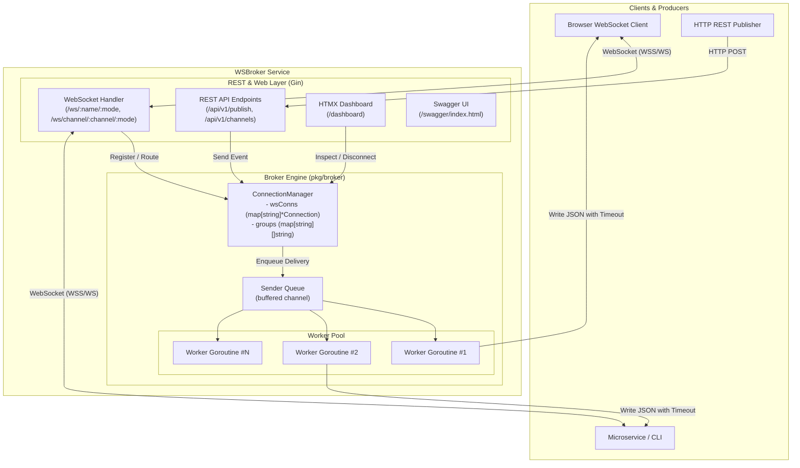
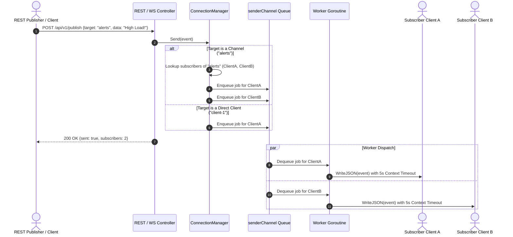
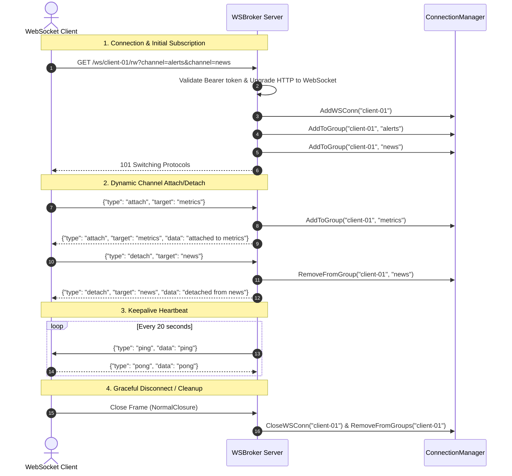

# WSBroker

[](https://pkg.go.dev/github.com/je4/wsbroker)
[](LICENSE)

**WSBroker** is a lightweight, high-performance WebSocket and Channel Message Broker written in Go. It enables real-time bidirectional communication, dynamic pub/sub channel routing, direct client-to-client messaging, RESTful event ingestion, and live system monitoring via an embedded Tailwind CSS & HTMX web dashboard.

---

## Table of Contents

- [Key Features](#key-features)
- [Architecture Overview](#architecture-overview)
- [Message Flow & Routing](#message-flow--routing)
- [Client Lifecycle & Channel Subscriptions](#client-lifecycle--channel-subscriptions)
- [WebSocket API](#websocket-api)
  - [Connection Endpoints](#connection-endpoints)
  - [Event Protocol Schema](#event-protocol-schema)
  - [Event Types](#event-types)
- [REST API Reference](#rest-api-reference)
- [Web Dashboard](#web-dashboard)
- [Configuration](#configuration)
- [Getting Started](#getting-started)
  - [Prerequisites](#prerequisites)
  - [Installation & Build](#installation--build)
  - [Running the Server](#running-the-server)
  - [Running Tests](#running-tests)
- [Client Integration Examples](#client-integration-examples)
  - [JavaScript / Browser WebSocket](#javascript--browser-websocket)
  - [cURL REST Publish](#curl-rest-publish)
- [License](#license)

---

## Key Features

- **Modern WebSocket Engine:** Powered by [`coder/websocket`](https://github.com/coder/websocket) with context-aware timeouts and concurrent safety.
- **Dynamic Channel / Group Pub-Sub:**
  - Subscribe upon connection via URL paths (`/ws/channel/:channel/:mode`) or query params (`?channel=alerts&channel=general`).
  - Dynamically join or leave channels at runtime using standard `attach` and `detach` WebSocket events.
- **High-Throughput Asynchronous Worker Pool:**
  - Inbound messages are enqueued into a buffered worker pipeline (`runtime.NumCPU()` parallel goroutines by default) preventing slow consumer blocking.
- **Dual Message Dispatching:**
  - **Broadcast:** Fan-out to all subscribed clients of a channel.
  - **Direct:** Point-to-point delivery to an individual client by name.
- **Interactive Web Dashboard:**
  - Real-time management interface at `/dashboard` built with [Tailwind CSS](https://tailwindcss.com/) and [HTMX](https://htmx.org/) (no complex node build steps required).
  - Live connection metrics, channel inspectors, client disconnection, and live broadcast test form.
- **RESTful Management & Publishing:**
  - HTTP endpoints for publishing events, querying channel statistics, listing clients, and terminating connections.
  - Interactive Swagger / OpenAPI documentation available at `/swagger/index.html`.
- **Security & Reliability:**
  - Bearer Token authentication on WebSocket connections and REST endpoints.
  - Full TLS / WSS encryption support.
  - Automatic Ping/Pong heartbeats and graceful shutdown handling.

---

## Architecture Overview



---

## Message Flow & Routing

When a message is published (via WebSocket or HTTP REST), `ConnectionManager` resolves whether the target is a broadcast channel or a direct client connection:



---

## Client Lifecycle & Channel Subscriptions



---

## WebSocket API

### Connection Endpoints

| Endpoint | Description |
| :--- | :--- |
| `GET /ws/:name/:mode` | Connect client with explicit name `:name` and mandatory access mode `:mode` (`rw`, `ro`, `wo`/`w`). |
| `GET /ws/channel/:channel/:mode` | Connect client, automatically subscribe to channel `:channel`, with mandatory access mode `:mode`. |

#### Connection Modes
- `rw` (Read-Write): Bidirectional client capable of publishing events and receiving channel broadcasts / direct messages.
- `ro` (Read-Only): Consumer client that receives broadcasts and messages, but is restricted from publishing events to channels or direct targets.
- `wo` or `w` (Write-Only): Producer / ingest client that can publish events, but does not receive any broadcasts or messages, eliminating unnecessary egress traffic.

#### Connection Query Parameters
- `channel`: Channel name to subscribe to on connect (multiple parameters supported, e.g. `?channel=alerts&channel=logs`).
- `bearer` or `token`: Bearer authentication token (when security is enabled in configuration).

---

### Event Protocol Schema

All WebSocket messages are encoded as JSON envelopes:

```json
{
  "type": "message",
  "source": "dashboard",
  "target": "alerts",
  "token": "optional-token",
  "data": "Server CPU load exceeds 85%"
}
```

| Field | Type | Description |
| :--- | :--- | :--- |
| `type` | `string` | The event type (`message`, `attach`, `detach`, `ping`, `pong`). |
| `source` | `string` | Sender identifier. |
| `target` | `string` | Destination channel name or client identifier. |
| `token` | `string` | Optional authentication or verification token. |
| `data` | `any` | Message payload (string, object, array, or raw JSON). |

---

### Event Types

- **`attach`**: Subscribes the client to a channel specified in `target`.
- **`detach`**: Unsubscribes the client from the channel specified in `target`.
- **`message`**: General broadcast or direct message.
- **`ping` / `pong`**: Heartbeat frames sent periodically to ensure connection vitality.

---

## REST API Reference

The server exposes a RESTful API under `/api/v1`:

| Method | Endpoint | Description |
| :--- | :--- | :--- |
| `GET` | `/api/v1/ping` | Health-check endpoint returning `pong`. |
| `POST` | `/api/v1/publish` | Publish a message or event to a channel or client target. |
| `POST` | `/api/v1/channel/:channel/publish` | Publish a message directly to `:channel`. |
| `GET` | `/api/v1/channels` | List all active channel names and subscriber counts. |
| `GET` | `/api/v1/channel/:channel/clients` | List client identifiers subscribed to `:channel`. |
| `GET` | `/api/v1/clients` | List all currently connected client identifiers. |
| `DELETE` | `/api/v1/client/:name` | Forcefully disconnect a client and remove subscriptions. |
| `GET` | `/swagger/index.html` | Interactive Swagger API Documentation. |

### Example: Publish via REST
```bash
curl -X POST "http://localhost:8080/api/v1/publish" \
  -H "Content-Type: application/json" \
  -H "Authorization: Bearer secret-token" \
  -d '{
    "source": "sensor-service",
    "target": "telemetry",
    "type": "message",
    "data": {"temperature": 21.5, "humidity": 45}
  }'
```

---

## Web Dashboard

WSBroker includes an embedded real-time management dashboard accessible at:

```
http://localhost:8080/dashboard
```

```mermaid
graph LR
    subgraph Dashboard UI
        A[Stats Summary Banner]
        B[Active Connections Table]
        C[Active Channels Grid]
        D[Publish Message Form]
    end

    subgraph HTMX Polling & Actions
        A -->|hx-get every 3s| S1[/dashboard/stats]
        B -->|hx-get every 3s| S2[/dashboard/connections]
        B -->|hx-delete| S3[/dashboard/connections/:name]
        C -->|hx-get every 3s| S4[/dashboard/channels]
        D -->|hx-post| S5[/dashboard/publish]
    end
```

- **Live Statistics:** Displays active connections, channels, and worker pool counts.
- **Connection Management:** View client TLS status, active channel subscriptions, and disconnect clients with one click.
- **Channel Inspector:** View channels, subscriber counts, and member client names.
- **Live Dispatch Form:** Send messages or custom JSON payloads directly to any channel or client.

---

## Configuration

WSBroker is configured via a TOML file (`wsbroker.toml`).

```toml
# Local bind address
localaddr = "0.0.0.0:8080"

# External address advertised to clients and Swagger UI
externaladdr = "http://localhost:8080"

# Bearer authentication token (optional)
bearer = "secret-token"

# Number of parallel worker goroutines for event dispatching (0 = NumCPU)
num_workers = 8

# Enable debug logging
debug = false

[log]
level = "debug"
file = ""

[resttls]
# TLS configuration (empty type = plain HTTP)
type = ""
```

Configuration files are searched in the following order:
1. Path provided via CLI flag: `-config /path/to/wsbroker.toml`
2. `~/.wsbroker.toml`
3. `/etc/wsbroker.toml`
4. `/opt/wsbroker/wsbroker.toml`
5. Embedded default configuration

---

## Getting Started

### Prerequisites
- [Go 1.22+](https://golang.org/dl/) installed.

### Installation & Build

Clone the repository and build the binary:

```bash
git clone https://github.com/je4/wsbroker.git
cd wsbroker
go build -o wsbroker.exe ./cmd/wsbroker
```

### Running the Server

```bash
./wsbroker.exe -config ./config/wsbroker.toml
```

Once started:
- **Dashboard:** Visit [http://localhost:8080/dashboard](http://localhost:8080/dashboard)
- **Swagger Documentation:** Visit [http://localhost:8080/swagger/index.html](http://localhost:8080/swagger/index.html)

### Running Tests

Execute the complete test suite:

```bash
go test -v -count=1 ./...
```

---

## Client Integration Examples

### JavaScript / Browser WebSocket

```javascript
const clientName = "browser-" + Math.floor(Math.random() * 1000);
const ws = new WebSocket(`ws://localhost:8080/ws/${clientName}/rw?channel=alerts`);

ws.onopen = () => {
    console.log("Connected to WSBroker as", clientName);
    
    // Subscribe to an additional channel dynamically
    ws.send(JSON.stringify({
        type: "attach",
        target: "notifications"
    }));
};

ws.onmessage = (event) => {
    const msg = JSON.parse(event.data);
    console.log("Received event:", msg);
};

// Send a broadcast message to the 'alerts' channel
function broadcastAlert(text) {
    ws.send(JSON.stringify({
        type: "message",
        source: clientName,
        target: "alerts",
        data: text
    }));
}
```

### cURL REST Publish

```bash
curl -X POST "http://localhost:8080/api/v1/channel/alerts/publish" \
  -H "Content-Type: application/json" \
  -d '{"source": "cli", "message": "Emergency system broadcast"}'
```

---

## License

This project is licensed under the Apache License 2.0 - see the [LICENSE](LICENSE) file for details.
