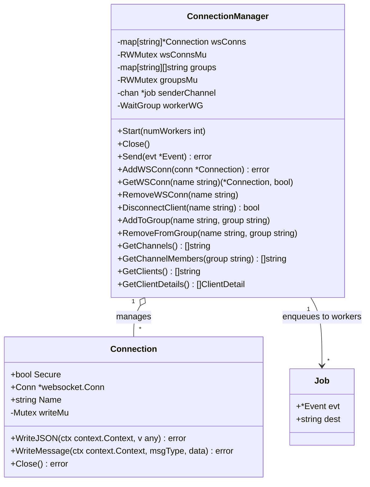
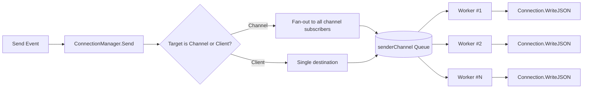

# Package `broker`

The `broker` package manages WebSocket connections, thread-safe group/channel memberships, and concurrent asynchronous message distribution across worker goroutines.

---

## Core Components

- **`Connection`**: Wraps a [`coder/websocket`](https://github.com/coder/websocket) socket connection. Provides mutex-guarded JSON/binary writing (`WriteJSON`, `WriteMessage`) and graceful disconnection (`Close`).
- **`ConnectionManager`**: The central broker instance managing:
  - Registered WebSocket connections (`wsConns: map[string]*Connection`).
  - Channel subscription lists (`groups: map[string][]string`).
  - Asynchronous worker dispatch queue (`senderChannel: chan *job`).

---

## Architecture Diagram



---

## Worker Pipeline & Dispatching



---

## Usage Example

```go
logger := zerolog.New(os.Stdout).With().Timestamp().Logger()
cm := broker.NewConnectionManager(false, &logger)

// Start with 4 worker goroutines
cm.Start(4)
defer cm.Close()

// Register a connection
conn := broker.NewConnection(wsConn, "client-123", true)
cm.AddWSConn(conn)

// Subscribe client to channel
cm.AddToGroup("client-123", "notifications")

// Send a broadcast message
evt, _ := event.NewMessageEvent("server", "notifications", "Hello Subscribers!")
cm.Send(evt)
```
