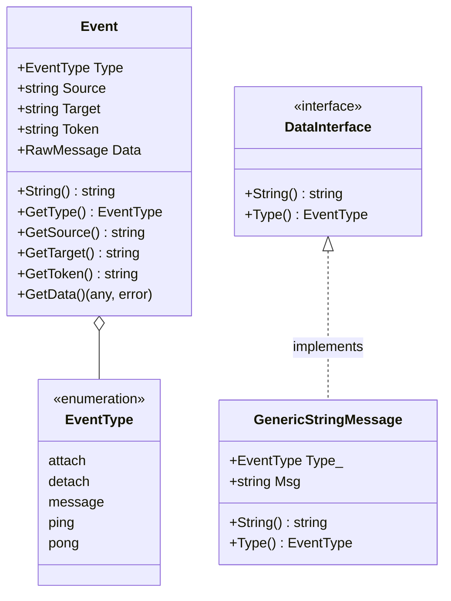

# Package `event`

The `event` package defines the universal JSON message envelope, serialization utilities, and standard event types exchanged across WSBroker.

---

## Event Model

Every message passed through WebSocket connections or the REST API is structured using the `Event` type:



---

## Event Types & Semantics

| EventType | Purpose | Payload (`data`) |
| :--- | :--- | :--- |
| `attach` | Subscribes the sending client to `target` channel. | Optional confirmation message or metadata. |
| `detach` | Unsubscribes the sending client from `target` channel. | Optional confirmation message. |
| `message` | General payload broadcast to `target` channel or client. | Arbitrary text, JSON object, or array. |
| `ping` | Periodic server-to-client heartbeat signal. | `"ping"` |
| `pong` | Client-to-server heartbeat acknowledgement. | `"pong"` |

---

## Creating Events in Go

```go
// 1. Create a generic broadcast message event
evt, err := event.NewMessageEvent("dashboard", "alerts", map[string]any{
    "severity": "CRITICAL",
    "details":  "Disk space below 5%",
})

// 2. Unmarshal payload
data, err := evt.GetData()
```
