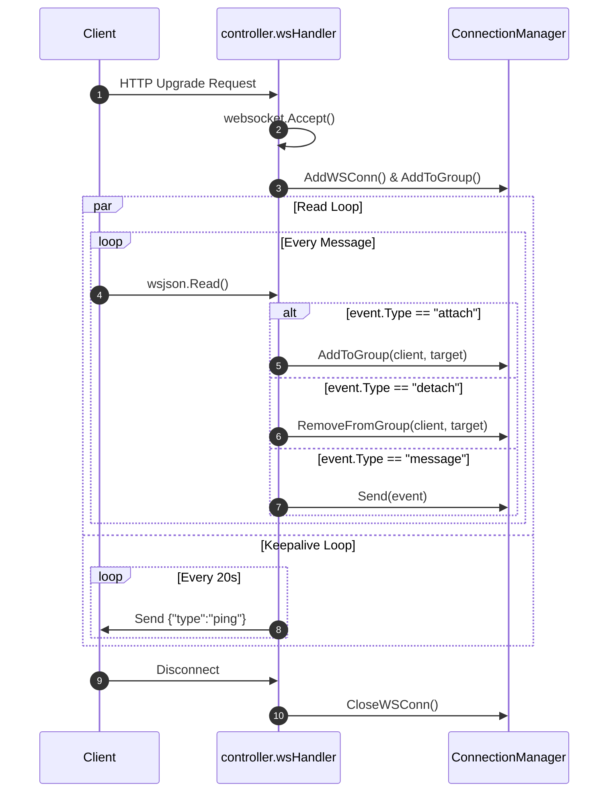

# Package `rest`

The `rest` package implements the Gin HTTP engine, WebSocket upgrader and protocol loop, REST API endpoints, Swagger UI documentation, and the embedded Tailwind CSS + HTMX real-time dashboard.

---

## Architecture & Endpoints

```mermaid
graph TB
    Router[Gin HTTP Router]

    subgraph "WebSocket Routes"
        WS1["/ws/:name/:mode"]
        WS2["/ws/channel/:channel/:mode"]
    end

    subgraph "REST API (/api/v1)"
        R1["POST /publish"]
        R2["POST /channel/:channel/publish"]
        R3["GET /channels"]
        R4["GET /channel/:channel/clients"]
        R5["GET /clients"]
        R6["DELETE /client/:name"]
        R7["GET /ping"]
        R8["GET /swagger/*"]
    end

    subgraph "Interactive Dashboard (/dashboard)"
        D1["GET /dashboard (Main View)"]
        D2["GET /dashboard/stats (Partial)"]
        D3["GET /dashboard/connections (Partial)"]
        D4["GET /dashboard/channels (Partial)"]
        D5["DELETE /dashboard/connections/:name"]
        D6["POST /dashboard/publish"]
    end

    Router --> WS1
    Router --> WS2
    Router --> WS3
    Router --> WS4
    Router --> R1
    Router --> R2
    Router --> R3
    Router --> R4
    Router --> R5
    Router --> R6
    Router --> R7
    Router --> R8
    Router --> D1
    Router --> D2
    Router --> D3
    Router --> D4
    Router --> D5
    Router --> D6
```

---

## WebSocket Session Loop

Each incoming WebSocket connection undergoes:
1. **Bearer Token Check:** (if configured).
2. **Upgrade:** `websocket.Accept(c.Writer, c.Request, ...)`
3. **Registration:** `broker.AddWSConn(conn)` & channel attachments from query parameters.
4. **Read Loop Goroutine:** Consumes incoming `attach`, `detach`, `message`, and `pong` events.
5. **Keepalive Ticker:** Sends periodic `ping` events every 20 seconds.
6. **Graceful Teardown:** Cleanup on disconnection or context cancellation.

---

## Dashboard Architecture

The dashboard is structured into modular embedded Go HTML templates (`templates/*.gohtml`) loaded via `//go:embed`:
- `dashboard.gohtml`: Full base HTML shell with navigation and Tailwind / HTMX headers.
- `stats.gohtml`: Summary metrics cards (Connections, Channels, Workers, Status).
- `connections.gohtml`: Active client connection table with TLS status and Disconnect buttons.
- `channels.gohtml`: Active channel grid with subscriber list and quick-publish trigger.
